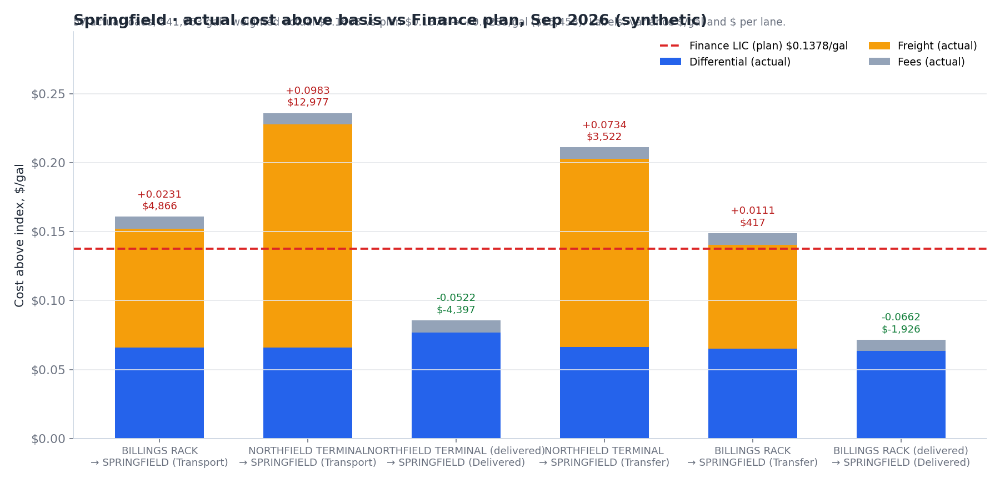

# Commercial optimization & analytics tools — propane supply

Three tools I built as a Commercial Optimization Analyst working on propane supply planning, hedging and cost control. Each folder has its own README with screenshots.

> **All data in these screenshots is synthetic.** Plant, terminal and supplier names, prices, volumes and freight rates are invented. The generators that produce them are included so every image can be reproduced.

| Project | What it does | Stack |
|---|---|---|
| [**Propane Supply Optimizer**](propane-supply-optimizer/) | Rebuilds an Excel/OpenSolver supply-and-transport linear program in Python, solves it with HiGHS, and wraps it in a local web app for planners | Python · NumPy · SciPy/HiGHS · openpyxl · Flask · vanilla JS |
| [**Hedge Product Tracker**](hedge-product-tracker/) | Daily blended forward-strip prices for hedge programs, weighted by origin mix and demand shape, with a growing multi-year look-back | Python · pandas · Parquet · openpyxl |
| [**Landed-Cost Data Quality**](landed-cost-data-quality/) | Pulls landed-cost detail from Snowflake, flags irregular data and outliers, and reconciles actual cost against Finance's plan | Python · pandas · Snowflake · openpyxl |

  

