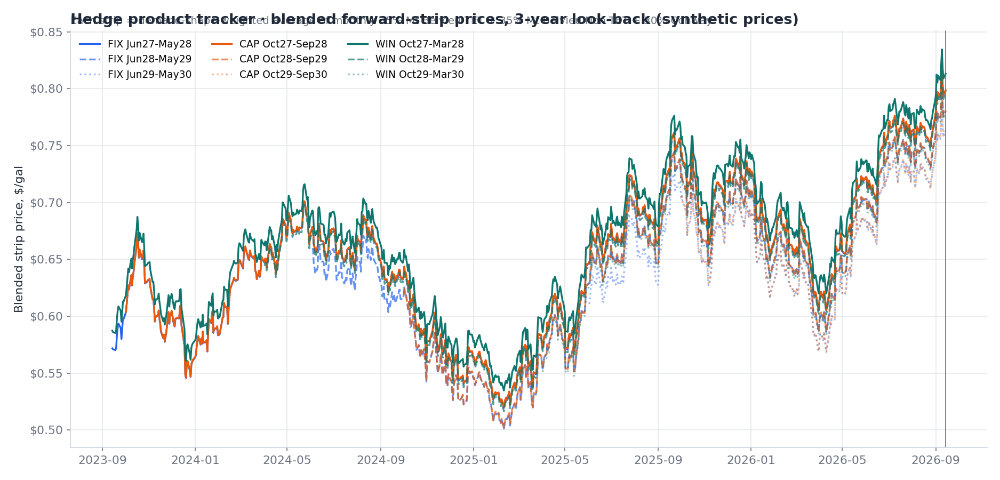
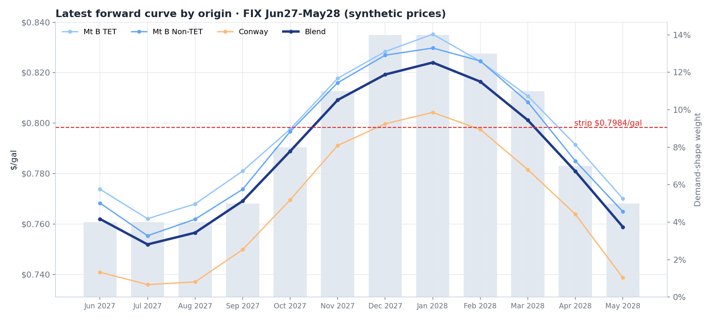
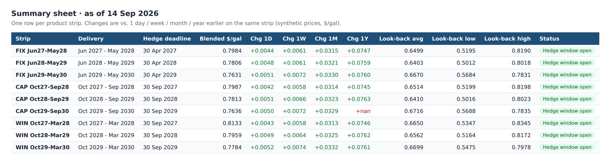

# Hedge Product Tracker

Tracks the daily price of each hedge program as a single **blended forward-strip price**, and keeps a multi-year look-back that grows as new price days arrive. It turns daily forward-curve files into one workbook a commercial team can check each morning, plus a long-format CSV for BI tools.


*Nine strips (three products × three delivery years), priced every business day over a three-year look-back. Prices are synthetic.*

## How a strip is priced

For every price date and every delivery month, the tracker does two things:

1. **Blends the origin hubs** using configurable weights, for example 35% Mont Belvieu TET + 35% Mont Belvieu Non-TET + 30% Conway. The weights are validated to sum to 1.
2. **Weights by demand shape.** Each product has its own monthly demand shape (annual fixed, annual capped, winter-only), normalized within the strip. The weighted average is the strip's $/gal price.

```
strip $/gal = Σ_month  shape_weight(month) × origin_blend(month)
```

Rules that keep the history honest:

- A day is only priced when **every** month of the strip is quoted, so far-dated strips start later in the look-back.
- A delivery month that rolls off the curve holds its last quoted price, so the strip stays priced through delivery.
- Hedge coverage scales gallons and notional value, never the $/gal price.


*The latest forward curve for one strip: the three origin curves, the blend (dark blue), the demand-shape weights (grey bars) and the resulting strip price.*

## What it produces

**`Hedge Product Tracker.xlsx`** has these sheets:

- **Summary:** each strip's price, with 1-day, 1-week, 1-month and 1-year changes, look-back average, low and high (with dates), first full quote and hedge-window status.
- **Charts**
- **Latest Curve:** month-by-month, with live SUM/SUMPRODUCT totals.
- **Daily Blend**
- **Origin Detail**
- **Methodology:** written from the config so it never drifts from the code.

**`hedge_tracker_history.csv`** is the long-format daily history for Power BI or Power Query.



## Data pipeline

- **`build_price_index.py`** parses daily Argus forward-curve exports (`ArgusFC_YYYYMMDD.csv`) into one long-format Parquet price store. It:
  - keeps only Mid Market valuations, which prevents a row-triplication bug;
  - keeps only monthly forward periods;
  - keeps only the three US propane hubs;
  - adds a synthetic blend index.
- **`hedge_tracker.py`** appends any Argus file newer than the store (keeping a `.bak` copy), then rebuilds every strip. It cross-checks its own recomputed blend against the pre-built blend index and reports the maximum absolute difference.
- **`hedge_products.json`** holds products, delivery windows, strip years, hedge deadlines, coverage, volumes and origin weights. No code changes are needed to add a program.
- **`update_tracker.bat`** is the one-click daily refresh.

## Run it (no real data needed)

```bat
py -m pip install pandas numpy pyarrow openpyxl
py make_sample_data.py     :: seeded random-walk forward curves + demand shapes
py hedge_tracker.py
```

**Stack:** Python, pandas, NumPy, Parquet (pyarrow), openpyxl charts.
