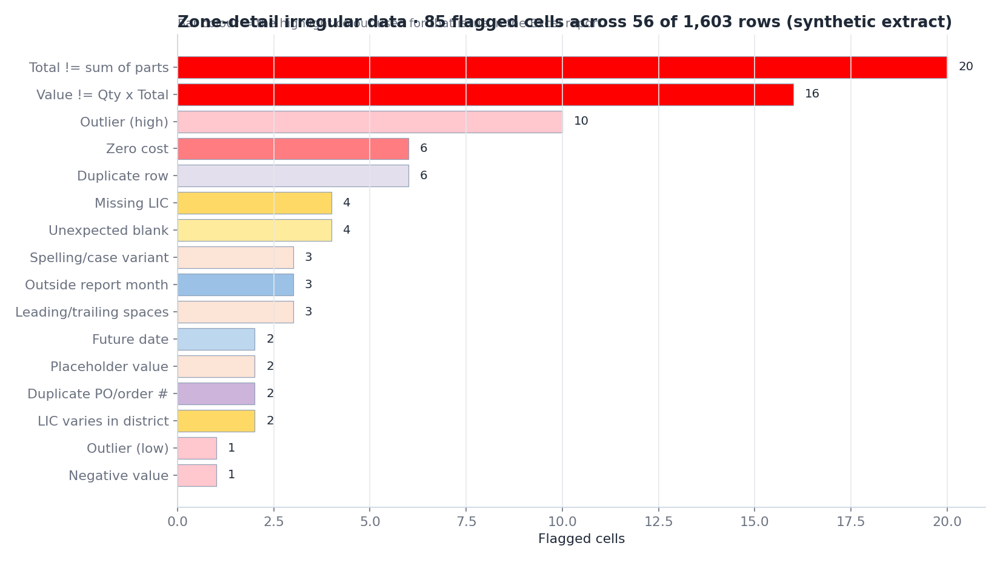
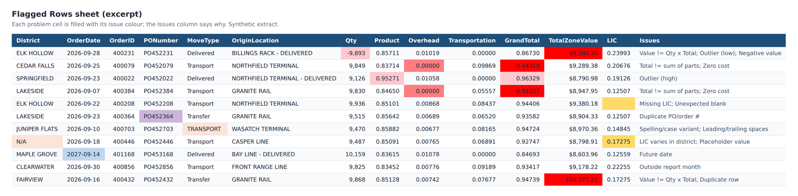
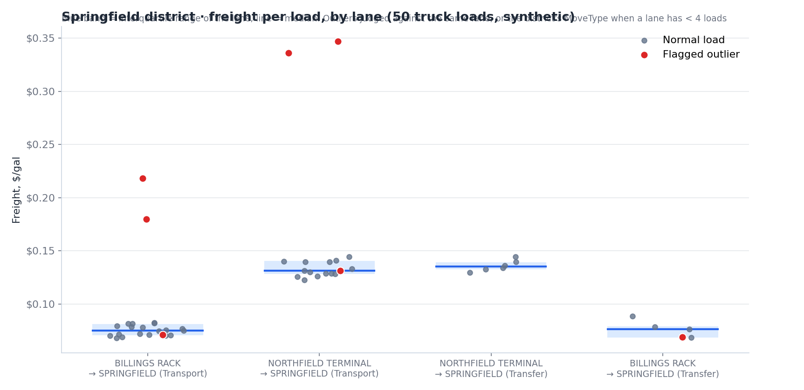

# Landed-Cost Data Quality & Finance Reconciliation

A set of Snowflake-backed reports that audit the landed-cost detail for every propane load and reconcile what was actually paid against Finance's planned landed cost (LIC). They answer two questions each month:

1. **Is the data trustworthy?** Find broken arithmetic, duplicates, placeholders and outliers before anyone builds a number on them.
2. **Where is cost running over plan, and why?** Split actual cost into differential, freight and fees for each district and lane, and compare it with Finance's plan.


*One district's actual cost above the index, by lane, against Finance's planned LIC. Labels show variance in $/gal and total $. Synthetic data.*

> All data shown is **synthetic**, including seeded errors so every check has something to find. See [`demo/make_zone_sample.py`](demo/make_zone_sample.py).

## The reports

| Script | Output | Purpose |
|---|---|---|
| `zone_detail_report.py` | *Zone Detail Irregular Data.xlsx* | Whole-table audit: every irregular cell, colour-coded, with charts and an issue log |
| `district_report.py` | *&lt;District&gt; Outliers vs Non-Outliers.xlsx* | One district, split into outlier and clean loads, with the reason for each flag |
| `district_cost_check.py` | *&lt;District&gt; LIC Check vs Finance.xlsx* | Actual cost above basis vs Finance LIC, by load, lane and month, with and without outliers |
| `district_vs_finance.py` | Side-by-side workbook | Every archived month for one district, Snowflake vs Finance |
| `pull_history.py` | *Zone Detail Raw &lt;year&gt;.xlsx* | Archives snapshots before Snowflake replaces them |
| `snowflake_connect.py` | — | Connection helper: browser SSO by default, credentials only from environment variables |

## What gets flagged



- **Landed-cost rules:**
  - `TotalZoneValue ≠ Qty × GrandTotal`
  - `GrandTotal ≠ Product + Overhead + Storage + Transportation`
  - zero fees or freight on moves that should have them
  - rows outside the report month
  - PO or TMW numbers shared across orders
  - LIC missing, or varying within a district-month
- **Numeric outliers:** beyond 3×IQR of rows sharing the same MoveType and State, *and* of the MoveType overall. Small peer groups fall back to a wider group. Stray negatives and text in number columns are also flagged.
- **Text hygiene:**
  - placeholders (`N/A`, `NULL`, `-`, `?`…)
  - leading or trailing spaces
  - case and spelling variants (`Zone A` vs `ZONE-A`)
  - very rare category values
- **Dates and structure:**
  - future, very old or invalid dates
  - gaps and spikes in rows per day, week or month
  - unexpected blanks
  - fully duplicated rows


*Each problem cell takes its issue's colour; the last column explains every flag on the row.*

## District outlier test

A load can look normal against the whole table but still be odd for its own lane. `district_report.py` therefore runs two tests:

- **Local:** compares each load with others on the same lane (origin → destination, move type). The load must fall outside 1.5×IQR *and* be at least 5% from the lane median. Lanes with fewer than 4 loads are compared with the district's loads of the same MoveType instead.
- **Wider:** the whole-table 3×IQR test above.

Each flag comes with a plain-English reason, for example: *"High Transportation 0.33626 is +156% vs NORTHFIELD TERMINAL → SPRINGFIELD (Transport), median 0.13127 (normal 0.111 to 0.157)."*



## Reconciling to Finance

Finance's LIC is a *planned* cost above basis: differential + freight + fees. To compare like with like, each actual load is rebuilt on the same basis:

```
Index                Mont Belvieu / Conway index on the order date
Differential         Product − Index
Actual above basis   Differential + Freight + Fees      ← compared with Finance LIC
Storage              reported separately (not in Finance's definition)
```

When Snowflake's index price is blank for a date, it is filled from the Argus prompt-month price plus its average offset to Snowflake. If that isn't available, it is interpolated, and the source of every fill is recorded. Forecast loads are excluded unless asked for. Results are shown both with and without outliers, so one bad load can't masquerade as a cost trend.

In the synthetic example, the district ran **+$0.0285/gal over plan ($15.5K)** on all loads, but only **+$0.0140/gal ($6.5K) excluding the flagged freight spikes**. Half of the apparent overrun was data, not cost.

## Snapshot archiving

The source table holds only the current snapshot: it is replaced on every refresh, and Snowflake Time Travel keeps just one day. `pull_history.py` therefore:

1. walks back through the Time Travel window;
2. archives every snapshot it can still reach to Parquet;
3. de-duplicates across snapshots, keeping the newest.

Run daily, this builds a month-over-month history the warehouse itself doesn't keep.

## Run it

```bat
py -m pip install pandas numpy pyarrow openpyxl snowflake-connector-python
set SNOWFLAKE_ACCOUNT=...   &  set SNOWFLAKE_USER=...
py zone_detail_report.py                                   :: pull + audit
py district_report.py --match "SPRINGFIELD" --from-file zone_detail_raw.parquet
py district_cost_check.py --match "SPRINGFIELD" --finance "finance_costs 2026-2027.xlsx"
```

Without Snowflake, run `py demo\make_zone_sample.py` (after `make_sample_data.py` from the hedge tracker for the price index), then use `--from-file zone_detail_raw.parquet`.

**Stack:** Python, pandas, NumPy, Snowflake connector (SSO), Parquet, openpyxl (conditional formats, charts).
