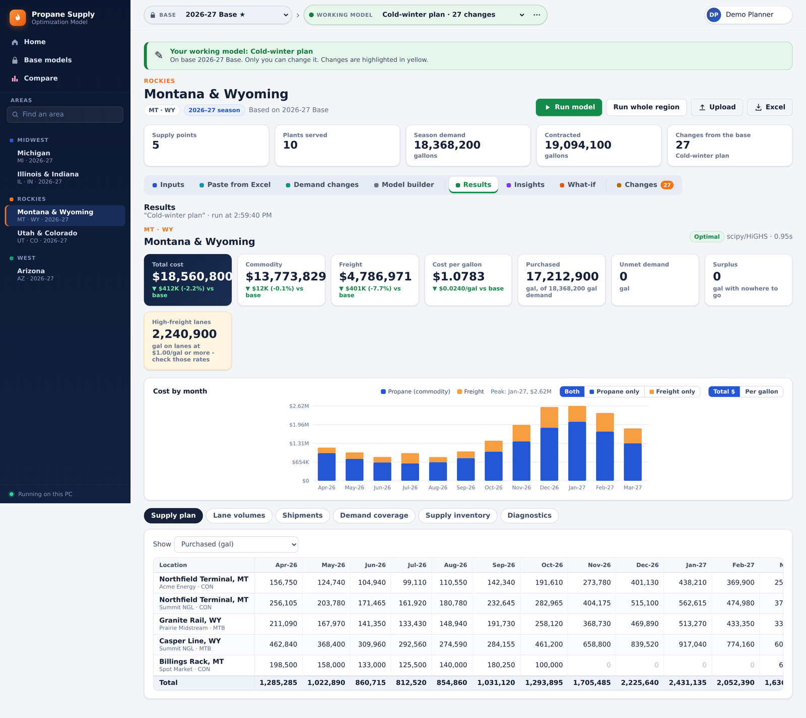
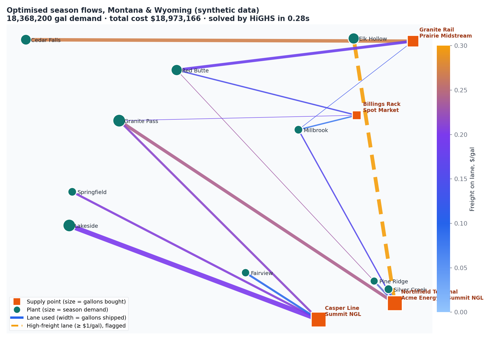
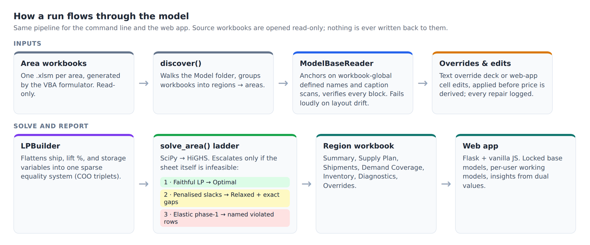
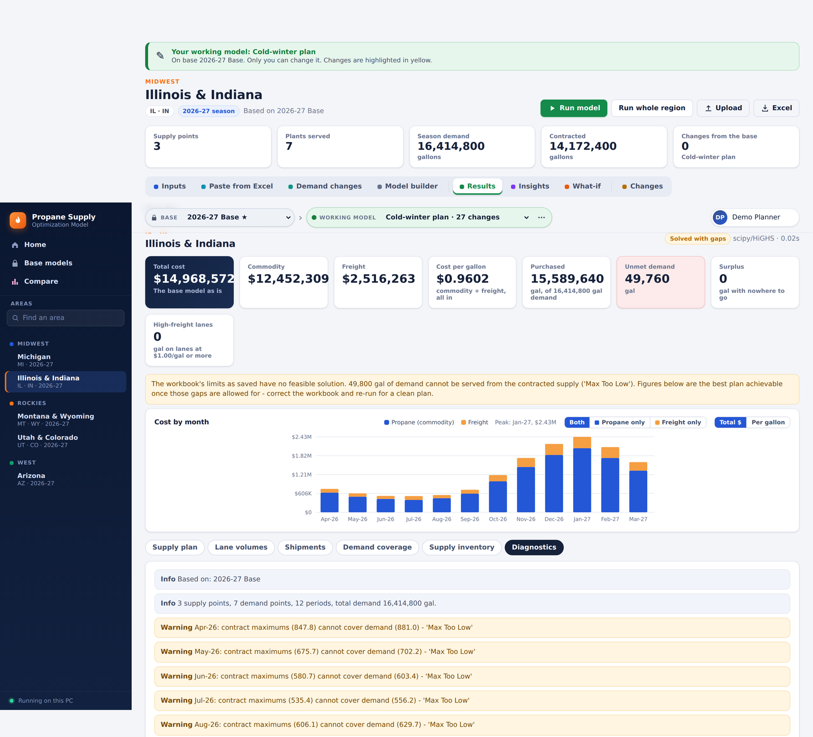
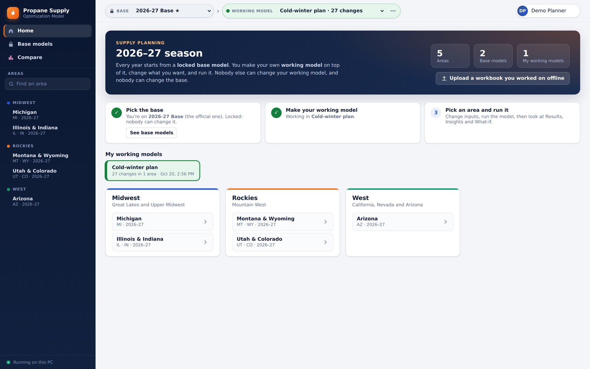
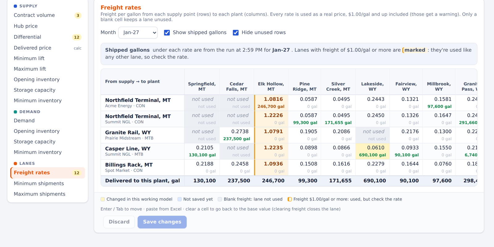
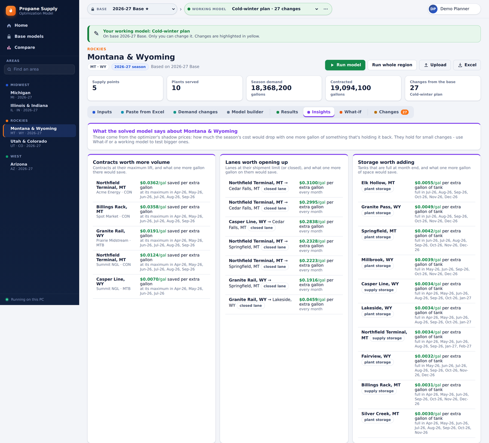
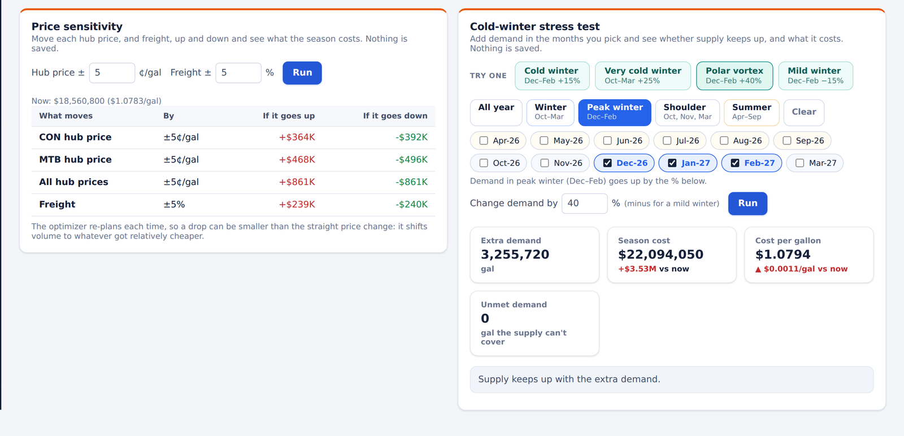
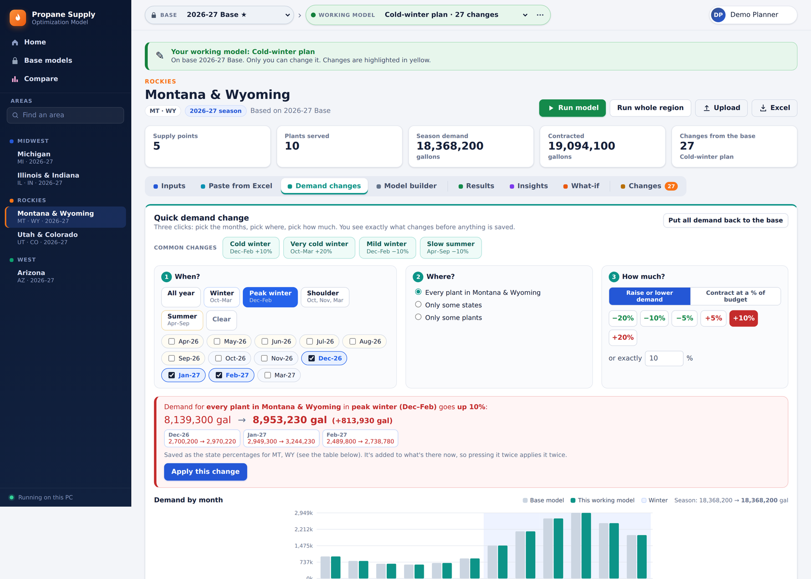
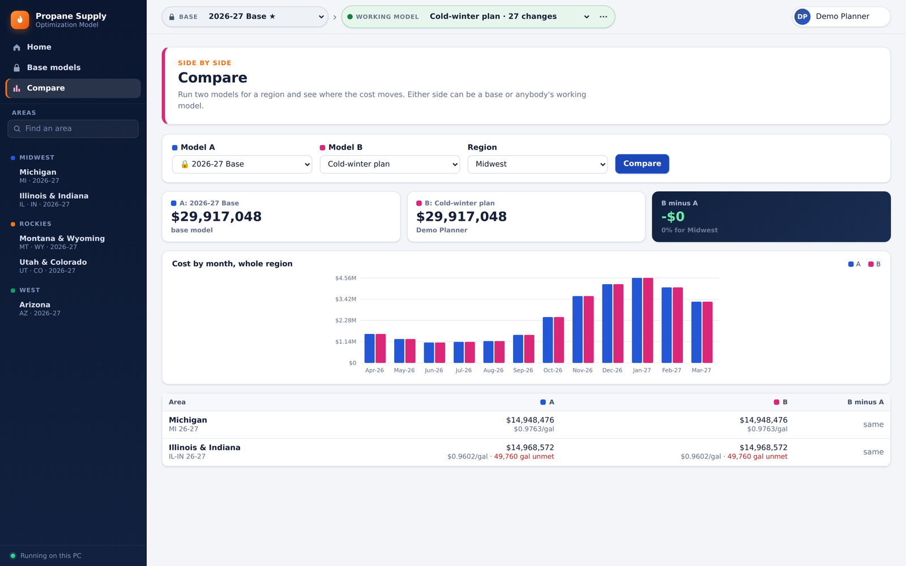

# Propane Supply Optimizer

A from-scratch Python rebuild of a propane supply and transport optimization that previously lived inside Excel macro workbooks and was solved with OpenSolver. It reads the **same input cells** from the **same workbooks**, rebuilds the **same linear program**, solves it with **HiGHS**, and writes one results workbook per region. A local **web app** on top lets planners edit inputs, run the model, and read results, shadow-price insights and stress tests without touching Excel.


*Results for one area: cost cards versus the untouched base, monthly propane and freight cost, and the optimized supply plan. Solved by HiGHS in about half a second.*

> All names, prices, volumes and freight rates shown are **synthetic**. See [`demo/make_synthetic_base.py`](demo/make_synthetic_base.py).

## The problem

Each **area** is an independent 12-month supply plan:

- buy propane from *N* contracted supply points;
- ship it to *M* plants;
- use storage at both ends to shift volume between months;
- minimize total cost.

In Excel this meant one workbook per area, a fragile solver add-in, and saved plans that silently went stale.

```
min  Σ_p [ Σ_ij freight[p,i,j]·ship[p,i,j]  +  Σ_i contract[p,i]·price[p,i]·lift%[p,i] ]

s.t. supply balance   contract·lift% + withdraw − (Σ_j ship + inject) = 0
     supply storage   end[p] = end[p−1] − withdraw + inject,   min ≤ end ≤ capacity
     demand balance   Σ_i ship + withdraw − (demand + inject) = 0
     demand storage   same shape as supply storage
     bounds           min_lift ≤ lift% ≤ max_lift,   min_ship ≤ ship ≤ max_ship
```

`price` is data, not a decision variable (hub price + differential), so the model stays a pure LP.


*What the optimizer decides: which lanes carry how much over the season. One remote plant can only be reached on lanes at $1/gal or more. These are used because they are the cheapest option, and are flagged for review.*

## How it works



**Defensive workbook reading.** Block positions in the generated workbooks look like a clean function of *N* and *M*, but they aren't: spacer rows differ between areas. So the reader anchors on workbook-global defined names plus caption scanning, verifies every block it finds, and raises a specific `ModelStructureError` rather than guess. Sheet-local names are ignored on purpose, because they point at *other* workbooks through stale external links. Unsupported generator features (alternate routes, fuel blending) are detected and refused, because a reader that ignored them would produce a confident, wrong answer.

**An escalating solve ladder for infeasible inputs.** Real workbooks are often over-committed: their own feasibility checks fail, and Excel's solver failed on them too. Returning nothing is the least useful answer, so `solve_area()` escalates in stages:

| Stage | Allows | Result |
|---|---|---|
| 1 | Nothing. Faithful to the sheet | `Optimal`: an answer Excel could have produced |
| 2 | Penalized slacks (unmet demand, surplus, excess, unsourced) at 1e7 | `Relaxed`, plus the exact volume and location of each gap |
| 3 | Elastic phase-1 on the balance rows at 1e9 | Named violated constraints, indicative only |

Inventory chains stay rigid at every stage, because they are accounting identities. Relaxation is never silent: the status changes, cells are highlighted, Diagnostics explains why, and the CLI exits with code 4.


*An over-committed area. The faithful LP is infeasible, so the model reports exactly how much peak-winter demand the contracts cannot cover, and where.*

**Fidelity is tested, not assumed.** Every clean-optimal area reproduces Excel's saved cost **to the dollar**, and every relaxed area reproduces Excel's own feasibility-gap volumes. `--compare-saved` is the regression oracle after any change to the reader or LP, and source workbooks are asserted unmodified by checking their modification times.

**Input repairs are reported, not hidden.** Examples include a minimum lift above the maximum, negative demand, and minimum storage above capacity. Each is clamped to the conservative side so the run can proceed, and logged as an Error so the source gets fixed.

**Manual overrides without touching the workbooks.** A plain-text override deck changes contracts, differentials, hub prices, lift limits, storage, demand and lane freight or limits. Values can be per area or blanket, and one value or twelve months. Anything that matches nothing is a **hard error** that names the line and suggests the nearest spellings. A typo that quietly does nothing is the worst failure mode for a planning input. `--check-overrides` validates a deck and echoes every resolved change (before → after) without solving.

## The web app

A local Flask app with a no-build vanilla-JS front end, built for planners who don't use the command line.



- **Base models and working models.** Each contract year has a locked **base model**: the raw model inputs, saved as read-only JSON, so the app runs without Excel. Each manager edits a **working model** that stores only their changes. Only the owner can edit it; others can view it and make their own copy. Next year's base is generated in the app from a base plus a new demand file, with an optional freight escalation.
- **Spreadsheet-style input grids.** Every input can be edited, and changes are highlighted and revertable cell by cell. After a run, each lane shows the exact gallons it carried. Edits are applied at the same point in the pipeline as the override deck, so every validation still runs.


*Freight grid for one month: grey = blank freight (lane closed), amber = $1/gal or more (used, but flagged), yellow = changed in this working model, and green figures = gallons the optimizer shipped.*

- **Insights from the LP's dual values.** These show:
  - contracts at their maximum and what one more gallon would save;
  - lanes worth opening, and storage worth adding;
  - the delivered cost of the next gallon at every plant;
  - a month-by-month contract-use strip.



- **What-if.** Price sensitivity moves each hub and freight up and down, and the optimizer re-plans each time. A cold-winter stress test adds demand in chosen months and reports unmet demand by plant.



- **Quick demand changes.** Three steps, no math: pick the months, pick where (whole area, states or plants), and pick how much. The app previews the result before saving and charts base vs. now.



- **Also included:**
  - **Paste from Excel:** detects layout, names and units, and previews changes before applying.
  - **Model builder:** adds supply points, plants, hubs or months.
  - **Upload:** reads a workbook someone worked on offline.
  - **Compare:** any two models, area by area and month by month.
  - **Export:** the same region workbook the CLI writes.



## Outputs

Each region produces one `.xlsx` with these sheets:

- Summary
- Supply Plan
- Shipments
- Demand Coverage
- Supply Inventory
- Demand Inventory
- Diagnostics
- Overrides

Non-optimal statuses are highlighted and explained in cell comments. Exit codes (0 clean, 4 relaxed, 3 unsolvable, 5 bad override deck) make the CLI safe to automate.

## Run it

```bat
py -m pip install numpy scipy openpyxl flask
py model.py --list-regions
py model.py --region Rockies
py model.py --check-overrides overrides_example.txt
py webapp\app.py                 :: http://127.0.0.1:8050
```

To try the web app without workbooks, run `py demo\make_synthetic_base.py` from the repo root. It writes a synthetic locked base into `webapp/data/bases/`.

**Security note:** the app binds to 127.0.0.1 only, checks the Host header, and requires a custom header on every request that changes data. That blocks DNS rebinding and cross-site requests. The name box prevents accidental overwrites but is not authentication. SSO, HTTPS and a production WSGI server are the documented prerequisites for sharing it.

**Stack:** Python 3.12, NumPy, SciPy (HiGHS), openpyxl, Flask, vanilla JS/CSS (no build step), Windows batch launchers for non-technical users.
